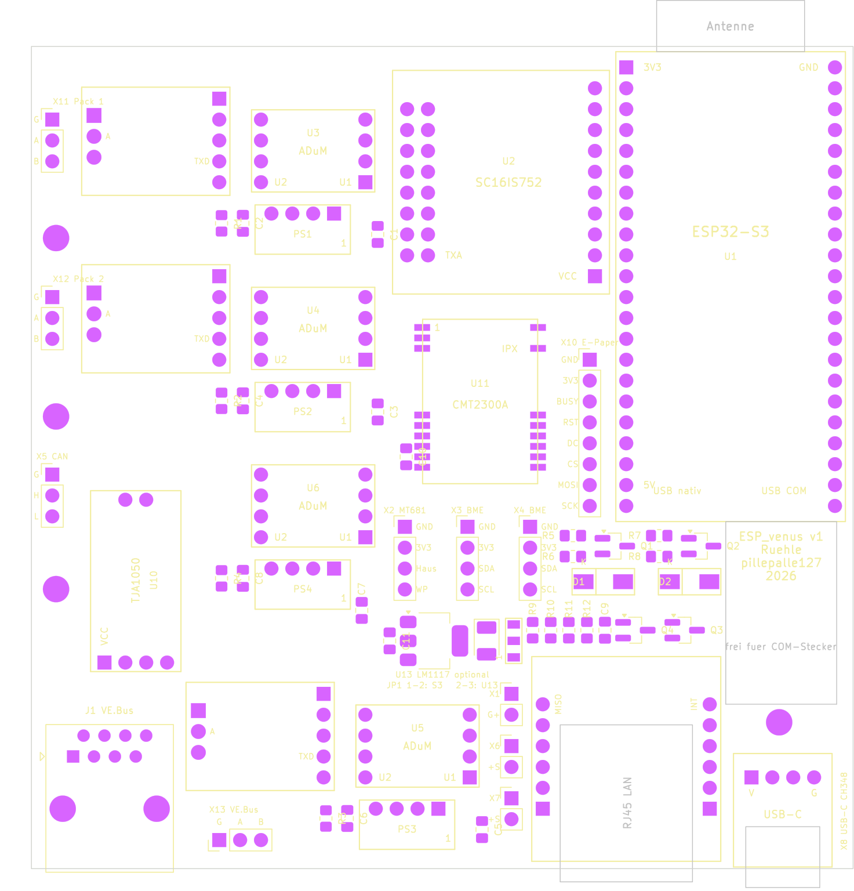

# Platine

Zusätzlich zum Lochraster gibt es eine eigene Platine, 100 × 100 mm. Die Schaltung ist die vom Lochraster, die Belegung steht in `firmware/src/pins.h`. Neu dazu kommen:

- die beiden Relaistreiber,
- die Filter-C an den B0505S,
- ein schaltbarer USB-Anschluss für den CH348 (X8),
- die Stiftleiste für das E-Paper (X10),
- die W5500 für LAN,
- ein eigener 3,3-V-Regler, optional.

Die neuen Pins (GPIO 21 für X8, GPIO 10 für die W5500, die Pins des E-Paper) kommen in `pins.h`, sobald die Platine gebaut ist.

Blockdiagramm mit Funktionszuordnung: [platine_block.drawio](platine_block.drawio). Die Pfeile zeigen die Signalrichtung.

## Vorgaben

- 100 × 100 mm für die günstigste Preisstufe bei JLCPCB. Die Preise selbst habe ich nicht nachgesehen.
- Alle Module oben. Sie werden mit ihren eigenen Stiftleisten direkt eingelötet, ohne Buchsenleisten.
- R und C in Bauform 0805, Pads für Handlötung. FETs in SOT-23, das CMT2300A auf seine Pads gelötet.
- Jedes Relais bekommt einen 2-poligen Pfostenstecker. An jedem B0505S sitzen Filter-C.
- Keine Schraubklemmen.
- Vor der COM-Buchse des eingelöteten S3-Boards bleibt Platz für Stecker und Kabel.
- Bei allen Pfostensteckern mit Masse liegt GND auf Pin 1.

## Stand (17.11.2026)

| Schritt | Stand |
|---|---|
| Maße der Module | fertig, siehe unten |
| Netzliste aus einer Quelle | fertig, Schaltplan und Platine stimmen überein |
| Platzierung, Leiterbahnen | fertig, Regelprüfung ohne Fehler |
| Fertigungsdaten (Gerber, Bohrdaten) | fertig |
| 1:1-Ausdruck mit aufgelegten Modulen | offen |
| Bestellung | offen |

## Layout

2 Lagen. Ansicht von oben:



- **Links, von oben:** Pack 1 und Pack 2 mit X11 und X12, darunter CAN mit X5 und TJA1050 (gedreht), unten VE.Bus mit der RJ45-Buchse J1 und daneben X13. Die RS485-Module ragen links nicht über den Rand.
- **Jede Kette:** RS485-Modul bzw. TJA1050, ADuM1201, darunter B0505S mit Cin, Cout und Lastwiderstand.
- **Mitte:** SC16IS752, darunter CMT2300A und X10. Darunter X2, X3, X4 nebeneinander, U13 mit C11, C12 und JP1, dann X1, X6, X7 senkrecht.
- **Rechts:** das S3-Board, die Antenne ragt über die Oberkante. Unter der nativen USB-Buchse sitzen die Relaistreiber und der 5-V-Schalter für X8.
- **Vor der COM-Buchse:** ein freier Streifen, x = 84,5 bis 98 mm, y = 57,8 bis 80 mm, auf der Platine gestrichelt markiert. Dort steht nur die Beschriftung „ESP_venus v1“, „Ruehle“, „pillepalle127“, „2026“. Dahinter läuft das Kabel, dort sitzt H4.
- **Unterkante:** W5500 mit RJ45 nach unten, X8 unten rechts mit der Buchse nach unten. Beide RJ45 und X8 zeigen nach unten, der rechte Rand ist frei von Steckern.
- **Befestigung:** 4 Löcher M3. H1, H2, H3 am linken Rand zwischen den Ketten, H4 am Ende des freien Streifens. Kein Loch liegt unter einem Modul.

Alle Stiftleisten liegen auf einem Raster von 1,27 mm.

### Busseiten

- **RS485-Module:** das kleine Modul mit MAX13487 („RS485 V2.05“). Stiftleiste 1 × 5 (GND, TXD, RXD, VCC, EN) und 1 × 3 (B, A, GND), 6 Raster auseinander. Maße aus dem Händlerfoto ausgemessen, etwa 18 × 12,6 mm. Die 3er-Reihe liegt auf beiden Fotos 0,44 bis 0,65 mm zur EN-Seite versetzt, der Footprint hat 0,5 mm Versatz und dort Bohrungen von 1,2 mm.
- **TX und RX:** „RX“ des Moduls geht auf Pin 4 des MAX13487, laut Datenblatt DI. „TX“ geht auf Pin 1, RO. TXD hängt an A1 (Eingang des ADuM), B0 (Ausgang) an RXD.
- **EN** liegt an VCC der Busseite: RE und SHDN brauchen laut Datenblatt beide High.
- **Pack 1 und Pack 2:** Pfostenstecker X11 und X12, 1 GND, 2 A, 3 B.
- **VE.Bus:** RJ45-Buchse J1, Pin 4 A, Pin 5 B, Pin 3 GND der VE.Bus-Seite. Pin 2 (+12 V vom Gerät) und die übrigen bleiben offen. Belegung laut Doku von esp32ess, nicht von mir gemessen. Als Alternative X13 rechts neben J1, Stiftleiste 1 × 3 liegend, 1 GND, 2 A, 3 B.
- **CAN:** X5, 1 GND, 2 CANH, 3 CANL.

### W5500

U12, Modul USR-ES1, an der Unterkante, RJ45 nach unten. Am SPI des SC16IS752 (MOSI GPIO 42, MISO 41, SCK 38), CS an GPIO 10, RST an RST des S3-Boards, INT frei. ESP-IDF fragt die W5500 dann ohne INT ab (`int_gpio_num = -1`, `poll_period_ms` > 0).

Belegung laut Handbuch des Herstellers ([USR-ES1 Manual](https://nettigo.pl/attachments/551), Diagramm 3-1 und 3-3), mit dem Aufdruck auf dem Händlerfoto abgeglichen: eine Reihe INT, CS, SCK, MOSI, GND, GND, die andere MISO, RST, NC, 3V3, 3V3, GND, 20,32 mm auseinander. Die Beschriftung auf dem zweiten Händlerbild (Ansicht von unten) ist die der Oberseite und damit seitenverkehrt.

SO des SC16IS752 und MISO der W5500 sind laut Datenblättern hochohmig, solange ihr CS high ist. Sie teilen sich deshalb den SPI.

### 3,3 V: eigener Regler, optional

U13 LM1117-3.3 (SOT-223) aus +5 V, mit C11 10 µF Keramik am Eingang und C12 10 µF Tantal am Ausgang. Laut Datenblatt von TI braucht der LM1117 am Ausgang mindestens 10 µF Tantal mit ESR 0,3 bis 22 Ω. Kühlfahne von U13, C12+ und Pad 3 von JP1 liegen in einer Reihe, 3V3_LDO läuft ohne Durchkontaktierung auf der Oberseite.

Die Lötbrücke JP1 legt fest, wer +3V3 liefert:
- **1-2:** Der Regler des S3-Boards versorgt alles. U13, C11, C12 bleiben unbestückt.
- **2-3:** U13 versorgt alle Module und Stecker an +3V3 (W5500, CMT2300A, ADuM, X2 bis X4, X10). Das S3-Board versorgt nur sich selbst.
- **Nie alle drei Pads verbinden,** sonst arbeiten zwei Regler gegeneinander. Auf der Platine steht „JP1 1-2: S3 2-3: U13“, Pad 1 ist markiert.

Die W5500 braucht laut Handbuch mindestens 200 mA aus 3,3 V. Wird der Regler des S3-Boards damit zu warm, U13 bestücken und JP1 auf 2-3. Die Verlustleistung an U13 habe ich nicht nachgerechnet.

## Regeln

| Was | Wert |
|---|---|
| Signalbahn | 0,4 mm |
| +5V, +3V3, GND, 3V3_ESP, 3V3_LDO, Relaisausgänge, VBUS | 0,8 mm |
| Bahnen auf den Busseiten | 0,5 mm |
| Abstand auf der Seite des S3 | 0,15 mm in KiCad, der Router hält 0,2 mm ein. Nur so passt eine Bahn zwischen zwei Pins im Raster 2,54 mm. |
| Abstand zu allem auf einer Busseite | 0,8 mm in KiCad, der Router hält 0,85 mm ein |
| Durchkontaktierung | 0,8 mm, Bohrung 0,4 mm |
| Abstand zwischen zwei Bohrungen | 0,55 mm, auch innerhalb einer Bahn |
| Kupfer bis zum Rand | 0,5 mm |

- **Trennung:** Zwischen der Seite des S3 und den Busseiten laufen zwei Streifen von 0,6 mm ohne Kupfer, auf beiden Lagen: bei x = 33,02 mm (Packs und CAN) und bei x = 45,72 mm (VE.Bus). Sie liegen unter den ADuM1201 und B0505S, in der Lücke zwischen Pin 2 (Vin) und Pin 3 (0V) der B0505S. Keine Bahn kreuzt sie.
- **GND-Fläche:** nur auf der Seite des S3, auf beiden Lagen. Die Busseiten haben keine Fläche.
- **CMT2300A:** Es liegt flach auf. Darunter ist die Oberseite ohne Kupfer: keine Bahn, keine Durchkontaktierung, keine Fläche. Pad 17 (ANT) hat kein Lötpad, darunter liegt kein Kupfer.
- **Antenne des WROOM:** ragt über den Rand, darunter liegt kein Kupfer.

## Massen und Abstände

- Es gibt fünf Massebereiche: S3, VE.Bus, CAN, Pack 1 und Pack 2.
- Die Grenze zwischen zwei Bereichen verläuft unter jedem ADuM1201 und jedem B0505S. Darunter läuft keine Leiterbahn und keine Kupferfläche von einer Seite zur anderen.
- Die engste Stelle liegt am B0505S zwischen Pin 2 (Vin) und Pin 3 (0V), im Raster 2,54 mm. Kein Abstand zwischen zwei Massen wird kleiner als dort.

## Prüfung (17.11.2026)

Gefunden und behoben:
- **Kupfer unter dem CMT2300A:** Oben liefen Signalbahnen und zwei Durchkontaktierungen unter dem Modul. Jetzt liegt dort oben kein Kupfer mehr.
- **Kleines RS485-Modul:** Versatz der 3er-Reihe, siehe oben.
- **Befestigungsloch H1:** lag zu dicht an der Ecke des Moduls Pack 2, jetzt 1,5 mm weiter oben.
- **Zwei Bohrungen fast übereinander:** Der Router setzte zwei Durchkontaktierungen desselben Netzes nur 0,05 mm auseinander. Er hält jetzt zwischen allen Bohrungen 0,55 mm Abstand.
- **3V3_LDO über zwei Durchkontaktierungen:** C12 war so gedreht, dass die Bahn zwischen C12 und JP1 nach unten musste. C12 ist um 180° gedreht, die Bahn liegt jetzt oben.

Geprüft, in Ordnung:
- Regelprüfung von KiCad: 0 offene Verbindungen, kein Abstandsfehler, kein Kurzschluss, kein Bohrabstandsfehler, kein überlappender Umriss.
- 70 Netze, 88 Durchkontaktierungen, 3,6 m Leiterbahn.
- Keine Bahn verlässt ihren Massebereich, kein Pad im freien Streifen vor der COM-Buchse.
- Jedes Signal hat genau einen Ausgang. Das prüft `gen_platine.py` bei jedem Lauf.
- Schaltplan gegen Platine: Die Netzliste des Schaltplans stimmt Pin für Pin mit der Platine überein (`gen_kicad_sch.py`).
- Polung von D1, D2, Belegung der SOT-23 (1 G, 2 S, 3 D), D− und D+ an X8.
- Bohrdaten: 88 × 0,4 mm, 8 × 0,76 mm, 193 × 1,0 mm, 9 × 1,2 mm, dazu 6 × 3,2 mm ohne Kupfer. Das passt zu Pads und Durchkontaktierungen der Platine.

Übrig bleiben Meldungen ohne elektrische Bedeutung:
- 65-mal „Footprint nicht in der Bibliothek“: Die Footprints der Module sind selbst gebaut.
- 39-mal Bestückungsdruck, meist Bezeichner, die auf ein Pad reichen. Der Fertiger schneidet den Druck dort ab. An X10 und X4 berührt sich Text, lesbar bleibt er.

Bleibt als Risiko, an der Platine nicht zu lösen:
- **Kleines RS485-Modul:** Alle Maße stammen aus Fotos. Passt die 3er-Reihe nicht, bleibt sie am Modul weg, und A, B, GND gehen mit drei Drähten auf die Platine.
- **Abschluss am VE.Bus:** Auf dem kleinen RS485-Modul sitzen laut Foto fest 120 Ω (Aufdruck 121) und zweimal 4,7 kΩ (472). VE.Bus muss laut esp32ess über 100 kΩ bleiben. Am Modul für VE.Bus (U9) vor dem Einlöten klären.
- **RJ45 J1:** Der Footprint ist der der Amphenol 54602-908. Andere Buchsen haben ein anderes Lochbild.
- **VE.Bus an J1** (Pin 4 A, Pin 5 B, Pin 3 GND) stammt aus der Doku von esp32ess und ist nicht gemessen.

### Mit dem 1:1-Ausdruck prüfen

`esp_venus_klein_usbfrei_1zu1.pdf` ohne Skalierung drucken, die Kontrolllinie nachmessen, dann die Module auflegen. Diese Maße stammen aus Fotos oder sind noch an keinem Teil geprüft:

- kleines RS485-Modul: beide Reihen, Versatz der 3er-Reihe,
- TJA1050: die beiden Reihen im Abstand von 19,8 mm,
- SC16IS752: Abstand und Versatz der Doppelreihe,
- CMT2300A: Lage der Pads,
- S3-Board: Reihenabstand und Lage der USB-C-Buchsen,
- USB-C-Modul X8: Lage der Stiftleiste zur Kante (2,9 mm, aus dem Foto) und wie weit die Buchse übersteht,
- B0505S: Lage des Gehäuses zu den Pins,
- J1: Lochbild der Buchse, die ich kaufe.

### Beim Bestücken

- Erst die SMD-Teile löten (R, C, D1, D2, Q1 bis Q4, U13, C12, CMT2300A), dann den Rest.
- JP1 setzen: 1-2 ohne U13, 2-3 mit U13.
- Die Brücke USB-OTG auf dem S3-Board bleibt offen. Sonst liegen die 5 V der Platine auch an der nativen USB-C-Buchse.
- Die Lastwiderstände R1 bis R4 bleiben frei.
- Am RS485-Modul für VE.Bus (U9) vorher den Abschluss klären, siehe oben.

## Fertigungsdaten

`hardware/platine/fertigung/esp_venus_klein_usbfrei.zip`, erzeugt mit:

```sh
sh hardware/platine/fertigung.sh hardware/platine/esp_venus_klein_usbfrei.kicad_pcb
```

| Datei | Inhalt |
|---|---|
| `-F_Cu.gtl`, `-B_Cu.gbl` | Kupfer oben, unten |
| `-F_Mask.gts`, `-B_Mask.gbs` | Lötstopp oben, unten |
| `-F_Silkscreen.gto`, `-B_Silkscreen.gbo` | Bestückungsdruck oben, unten (unten leer) |
| `-Edge_Cuts.gm1` | Umriss 100 × 100 mm |
| `-PTH.drl`, `-NPTH.drl` | Bohrungen mit und ohne Kupfer, Excellon, mm |

2 Lagen, 1,6 mm. Kleinste Bahn 0,4 mm, kleinster Abstand 0,15 mm, kleinste Bohrung 0,4 mm, Durchkontaktierungen mit Lötstopp abgedeckt. Die Gerber habe ich mit einem zweiten Programm (gerbonara) eingelesen: alle Lagen erkannt, Umriss 100 × 100 mm, Bohrungen sitzen mittig in den Pads.

## Dateien

Alles liegt in [hardware/platine/](../hardware/platine/).

| Datei | Inhalt |
|---|---|
| `esp_venus_klein_usbfrei.kicad_pcb`, `.kicad_pro` | Platine für KiCad 7 |
| `schaltplan_usbfrei.pdf`, `.kicad_sch` | Schaltplan, ein Blatt A3, mit Symbolen. Nach Funktion gegliedert: vier Busketten, Versorgung mit U13 und JP1, ESP32-S3, SPI, Funk, Sensoren, Relaistreiber, 5-V-Schalter |
| `esp_venus_klein_usbfrei_1zu1.pdf` | Bestückungsseite im Maßstab 1:1 auf A4 quer, mit Kontrolllinie 100 mm |
| `bestueckung_klein_usbfrei.png` | Bestückungsdruck mit Pads |
| `kupfer_oben_klein_usbfrei.png`, `kupfer_unten_klein_usbfrei.png` | die beiden Kupferlagen |
| `vorschau_3d_klein_usbfrei.png` | vereinfachte 3D-Ansicht |
| `esp_venus_klein_usbfrei_netze.txt` | Netzliste: jedes Netz mit seinen Pins |
| `esp_venus_klein_usbfrei_drc.txt` | Bericht der Regelprüfung von KiCad |
| `esp_venus_klein_usbfrei_stueckliste.md` | Stückliste |
| `fertigung/` | Gerber und Bohrdaten, als Ordner und als ZIP |
| `3d/` | 3D-Modelle der Bauteile |
| `gen_platine.py` | erzeugt Footprints, Netzliste und Platzierung |
| `route.py` | legt die Leiterbahnen, füllt die GND-Flächen und startet die Regelprüfung |
| `gen_kicad_sch.py` | erzeugt den Schaltplan aus den Netzen der Platine und vergleicht danach die Netzliste des Schaltplans Pin für Pin mit der Platine |
| `stueckliste.py` | erzeugt die Stückliste aus der Platine |
| `bilder.py` | erzeugt Bilder und 1:1-PDF |
| `modelle_3d.py` | erzeugt die 3D-Modelle, trägt sie in die Platine ein und zeichnet die 3D-Vorschau |
| `fertigung.sh` | erzeugt Gerber und Bohrdaten |

Die Schaltung steht als Netzliste in `gen_platine.py`. Platine und Schaltplan werden daraus erzeugt. Wer etwas ändert, ändert es dort und erzeugt alles neu.

Neu erzeugen, auf einem Rechner mit KiCad 7 (Python-Modul `pcbnew`, `kicad-cli`), numpy und PyMuPDF, als normaler Benutzer im Ordner des Repos:

```sh
python3 hardware/platine/gen_platine.py
python3 hardware/platine/route.py
KICAD7_SYMBOL_DIR=<Pfad zu den KiCad-Symbolen> python3 hardware/platine/gen_kicad_sch.py
python3 hardware/platine/stueckliste.py hardware/platine/esp_venus_klein_usbfrei.kicad_pcb
python3 hardware/platine/bilder.py
sh hardware/platine/fertigung.sh hardware/platine/esp_venus_klein_usbfrei.kicad_pcb
python3 hardware/platine/modelle_3d.py hardware/platine/esp_venus_klein_usbfrei.kicad_pcb hardware/platine/vorschau_3d_klein_usbfrei.png
```

`gen_platine.py` überschreibt die geroutete Platine. Danach immer `route.py` und `modelle_3d.py` laufen lassen.

Prüfen:

```sh
grep -E "Found|^\[" hardware/platine/esp_venus_klein_usbfrei_drc.txt | sed 's/:.*//' | sort | uniq -c
```

In Ordnung ist: 0 `unconnected pads`, kein `clearance`, kein `shorting_items`, kein `hole_near_hole`.

## 3D-Ansicht

`modelle_3d.py` erzeugt für jedes Bauteil ein einfaches 3D-Modell (Quader, VRML) in `hardware/platine/3d/` und trägt es mit `${KIPRJMOD}/3d/…` in die Platine ein. Damit zeigt jede KiCad-Version die bestückte Platine im 3D-Betrachter (Alt+3), ohne installierte 3D-Bibliothek. Das Kupfer ändert sich dabei nicht.

Grundflächen und Lage der Stifte sind die der Footprints. Die Module zeigen ihre Leiterplatte, die Stifte und einen IC-Block in der Mitte. Wo die Lage bekannt ist, kommen WROOM und USB-C-Buchsen (S3-Board), RJ45 (W5500) und die Buchse des USB-C-Moduls dazu. Die Höhen sind geschätzt, nur der Abstand der Module zur Platine nicht:

| Maß | Wert | Quelle |
|---|---|---|
| Module über der Platine (Kunststoff der Stiftleiste) | 2,5 mm | Stiftleiste |
| Leiterplatte eines Moduls | 1,6 mm | geschätzt |
| WROOM auf dem S3-Board | 3,2 mm | geschätzt |
| USB-C-Buchsen (S3-Board, X8) | 3,3 mm | geschätzt |
| RJ45 der W5500 | 13,5 mm | geschätzt |
| RJ45 J1 | 13,5 mm | geschätzt |
| B0505S | 10,2 mm | geschätzt |
| CMT2300A-Modul | 1,0 mm, Chip 0,9 mm | geschätzt |
| Stifte der Stiftleisten über der Platine | 8,5 mm | geschätzt |

## Maße der Module

Die Quellen sind:
- Maßzeichnungen und bemaßte Fotos der Händler vom 16.11.2026 (in `docs/`, nur lokal),
- das Handbuch der W5500 (USR-ES1),
- meine Messungen vom 16.11.2026.

Wo ein Wert aus einem Foto ausgemessen ist, steht das dabei. Den Maßstab dafür liefert das Pinraster von 2,54 mm im selben Foto.

| Modul | Anzahl | Maße |
|---|---|---|
| ESP32-S3-Board N16R8, 2 × USB-C | 1 | <ul><li>Platine 27,94 × 57,15 mm, 2 × 22 Pins.</li><li>Reihenabstand 25,40 mm.</li><li>Pinmitte bis Längskante 1,27 mm, bis Querkante 1,905 mm.</li><li>Das WROOM ragt an der Antennenseite 6,24 mm über die Platine.</li><li>Quelle: Maßzeichnung des Händlers.</li></ul> |
| SC16IS752 (CJMCU-752) | 1 | <ul><li>27,2 × 26,4 mm.</li><li>Einzelreihe 1 × 10, Doppelreihe 2 × 8.</li><li>Die innere Doppelreihe liegt 8 Raster (20,32 mm) neben der Einzelreihe, die äußere 9 Raster (22,86 mm). Ausgemessen.</li><li>Die Doppelreihe ist um 1 Raster versetzt: GP7 und TXA liegen neben GND, GP0 und CTSB neben SCL/SCLK.</li><li>Innen liegt GP7 bis GP0, außen TXA bis CTSB (Foto der Unterseite).</li><li>Pin bis Kante etwa 2 mm, aus dem Foto.</li><li>Auf dem Modul sitzt ein AMS1117-3.3 (SOT-223), siehe unten.</li></ul> |
| ADuM1201-Modul | 4 | <ul><li>15 × 10 mm, 2 × 4 Pins.</li><li>Reihenabstand 12,70 mm (5 Raster): 4 freie Reihen dazwischen, auf dem Lochraster gezählt.</li><li>Seite 1: U1, A0, B1, G1. Seite 2 gegenüber: U2, A1, B0, G2.</li></ul> |
| RS485-Modul MAX13487 („RS485 V2.05“) | 3 | <ul><li>etwa 18 × 12,6 mm, aus dem Händlerfoto.</li><li>1 × 5: GND, TXD, RXD, VCC, EN. 1 × 3: B, A, GND, 6 Raster daneben, 0,5 mm zur EN-Seite versetzt.</li></ul> |
| TJA1050-Modul | 1 | <ul><li>22 × 11 mm.</li><li>1 × 4: VCC, TX, RX, GND.</li><li>CANH liegt neben TX, CANL neben RX.</li><li>Von Mitte TX bis Mitte CANH sind es 19,8 mm (gemessen). Das liegt nicht im 2,54-mm-Raster, der Footprint hat zwei getrennte Reihen.</li></ul> |
| W5500-Modul USR-ES1 | 1 | <ul><li>23 × 25 mm, 2 × 6 Pins, Reihen 20,32 mm auseinander.</li><li>Pin 1 liegt 6,40 mm von der Kante an der Buchse, Pin 6 5,80 mm von der anderen Kante. Die Buchse steht 2,5 mm über.</li><li>Quelle: Handbuch des Herstellers.</li></ul> |
| USB-C-Modul | 1 | <ul><li>12 × 13,8 mm, Stifte V, D−, D+, G.</li><li>Reihe 2,9 mm von der Kante gegenüber der Buchse, mittig. Aus dem Händlerfoto.</li></ul> |
| B0505S-1WR3 | 4 | <ul><li>SIP-4 im Raster 2,54 mm.</li><li>Pin 1 GND, 2 Vin, 3 0V, 4 +Vo.</li><li>Gehäuse 11,6 × 6,0 × 10,16 mm, Bohrung 1,0 mm.</li><li>Quelle: Datenblatt Mornsun B_S-1WR3. Die Pinfolge ist die vom Lochraster, mit der die CAN-Kette läuft.</li></ul> |
| CMT2300A, Modul 10298-V1.0 | 1 | <ul><li>14,0 × 20,0 × 3,0 mm, 18 Lötpads (Halblöcher) im Raster 1,27 mm.</li><li>Je Seite liegt eine Gruppe aus 6 und eine aus 3 Pads.</li><li>Pad 10 ist 2,00 mm von der Kante entfernt, zwischen Pad 15 und 16 liegen 8,11 mm, Pad 18 ist 1,00 mm von der Kante entfernt.</li><li>Belegung: 1–4 GND, 5 GPIO1, 6 GPIO2, 7 GPIO3, 8 VCC, 9 GND, 10 GND, 11 SCLK, 12 SDIO, 13 CSB, 14 FCSB, 15 GND, 16 GND, 17 ANT (50 Ω), 18 GND.</li><li>Laut Zeichnung sitzt eine IPX-Buchse auf der Oberseite neben ANT.</li><li>Die Belegung stimmt mit der Beschriftung auf meinem Modul überein (Foto der Unterseite vom 15.11.2026).</li></ul> |

## SC16IS752: Versorgung über VCC an 5 V

Auf dem CJMCU-752 sitzt ein AMS1117-3.3. Laut Foto des Händlers geht die Leiterbahn von VCC an Pin 3 des Reglers (Eingang). Pin 2 (Ausgang) versorgt den Chip.

Hängt VCC an 3V3, bekommt der Chip die 3V3 abzüglich der Spannung, die am Regler abfällt:

- **AMS1117:** Der Abfall beträgt laut Datenblatt typisch 1,1 V, höchstens 1,3 V, und wird bei kleinerem Strom geringer. Für den kleinen Strom des SC16IS752 nennt das Datenblatt keinen Wert.
- **SC16IS752:** Er läuft laut Datenblatt mit 2,5 V ± 0,2 V oder 3,3 V ± 0,3 V. Zwischen 2,7 und 3,0 V ist nichts angegeben. Bei 2,5 V liegt seine Ausgangsspannung für High bei mindestens 1,85 V (400 µA).
- **Empfänger der Ausgänge:**
  - SO geht an den S3. Der erkennt High erst ab 0,75 × 3,3 V = 2,48 V.
  - TXA und TXB gehen an Seite 1 der ADuM1201. Die erkennen High erst ab 0,7 × 3,3 V = 2,31 V.

  Mit 2,5 V am Chip sind beide Pegel nicht gesichert.

Mit VCC an 5 V macht der Regler 3,3 V. Dann passen alle Pegel:
- Die Ausgänge haben bei 3,3 V mindestens 2,4 V (4 mA).
- Die Eingänge sind laut Datenblatt bis 5,5 V verträglich und erkennen High ab 2,0 V.

nopnop2002, dessen Treiber ich als Quelle nutze, schließt das Modul genauso an 5 V an.

**Festgelegt am 16.11.2026:** VCC des SC16IS752 an +5V, RESET bleibt an 3V3. Der Lochraster-Plan ist genauso geändert. Dass SPI und Schleife (A6b) mit 3V3 liefen, heißt nur, dass es zufällig gereicht hat.

## Steckverbindungen

### Nach außen

| Name | Bauform | Pins | Masse | Geht an |
|---|---|---|---|---|
| X1 5 V | Pfostenstecker 1 × 2 | 1 GND, 2 +5V | S3 | Netzteil (A1 noch offen) |
| X2 MT681 | Pfostenstecker 1 × 4 | GND, 3V3, Haus (GPIO 7), WP (GPIO 6) | S3 | Leseköpfe Haus und WP |
| X3 BME280 1 | Pfostenstecker 1 × 4 | GND, 3V3, SDA (GPIO 16), SCL (GPIO 15) | S3 | BME280 |
| X4 BME280 2 | Pfostenstecker 1 × 4 | GND, 3V3, SDA (GPIO 16), SCL (GPIO 15) | S3 | BME280 |
| X5 CAN | Pfostenstecker 1 × 3 | GND, CANH, CANL | CAN-Seite | JK-BMS |
| X6 Relais Lüfter | Pfostenstecker 1 × 2 | 1 +5V, 2 Schalter (Drain AO3402, GPIO 11) | S3 | Spule des Finder-Relais Lüfter |
| X7 Relais 2 | Pfostenstecker 1 × 2 | 1 +5V, 2 Schalter (Drain AO3402, GPIO 12) | S3 | Spule Relais 2 |
| X8 CH348 | USB-C-Modul 12 × 13,8 mm, eingelötet (V, D−, D+, G) | VBUS über den 5-V-Schalter (GPIO 21), D− GPIO 19, D+ GPIO 20, GND | S3 | CH348, extern am USB-Kabel, dahinter 6 MPPT und SmartShunt |
| X10 E-Paper | Pfostenstecker 1 × 8 | GND, 3V3, BUSY (GPIO 1), RST (GPIO 18), DC (GPIO 17), CS (GPIO 47), MOSI (GPIO 40), SCK (GPIO 39) | S3 | E-Paper-Display, optional |
| X11 Pack 1 | Pfostenstecker 1 × 3 | GND, A, B | Pack 1 | JK-BMS Pack 1 |
| X12 Pack 2 | Pfostenstecker 1 × 3 | GND, A, B | Pack 2 | JK-BMS Pack 2 |
| J1 VE.Bus | RJ45 (Amphenol 54602-908) | 3 GND, 4 A, 5 B | VE.Bus-Seite | MultiPlus-II, RJ45-Kabel |
| X13 VE.Bus | Pfostenstecker 1 × 3, liegend | GND, A, B, parallel zu J1 | VE.Bus-Seite | Alternative zu J1 |
| LAN | RJ45 auf der W5500 | | S3 | Netzwerk |
| USB-C COM | Buchse am S3-Board | UART0, GPIO 43, 44 | S3 | PC, nur zum Flashen |
| USB-C nativ | Buchse am S3-Board | bleibt frei, der CH348 hängt an X8 | | |
| Antenne | IPX-Buchse auf dem CMT2300A | | | HMS-2000 WP, HMS-1600 Garage |

- **X8:** Die Brücke USB-OTG auf dem S3-Board bleibt offen. Sonst liegen die 5 V der Platine auch an der nativen USB-C-Buchse.
- **X8:** D− und D+ kommen über die Stiftleiste des S3-Boards (GPIO 19, 20). Die Leitungen zur nativen Buchse bleiben auf dem Board dran.
- **X8, 5-V-Schalter:** Er ist beim Start aus, die Firmware schaltet ihn ein. So bekommt der CH348 bei jedem Start von ESP_venus frische 5 V (Test A8).
- **X10:** Die Reihenfolge der Pins ist die der früheren E-Paper-Stiftleiste auf dem Lochraster.
  - Weiter genutzt werden BUSY, MOSI und SCK auf GPIO 1, 40 und 39.
  - RST, DC und CS lagen auf GPIO 2, 42 und 41, die jetzt der SC16IS752 belegt.
- **X10, eigene Pins:** Das E-Paper teilt sich nicht den SPI mit dem SC16IS752. Den fragt die Firmware jede Millisekunde ab, ein langes Bild-Update auf demselben Bus könnte das aufhalten.
- **Freie Pins des S3:** IO0, IO35, IO36, IO37, IO43, IO44, IO45, IO48 gehen auf keinen Stecker.

### Module auf der Platine

| Modul | Steckplatz | Pins in Reihenfolge |
|---|---|---|
| ESP32-S3-Board | Stiftleisten 2 × 22, eingelötet | links: 3V3, 3V3, RST, 4, 5, 6, 7, 15, 16, 17, 18, 8, 3, 46, 9, 10, 11, 12, 13, 14, 5V, GND. Rechts: GND, 43, 44, 1, 2, 42, 41, 40, 39, 38, 37, 36, 35, 0, 45, 48, 47, 21, 20, 19, GND, GND |
| SC16IS752 | Stiftleisten 1 × 10 und 2 × 8, eingelötet | Einzelreihe: VCC, GND, RESET, A0/CS, A1/SI, NC/SO, IRQ, I2C/SPI, SCL/SCLK, SDA/VSS. Doppelreihe innen GP7 bis GP0, außen TXA, RXA, RTSA, CTSA, TXB, RXB, RTSB, CTSB |
| ADuM1201, 4 × | Stiftleisten 2 × 4, eingelötet | Seite 1: U1, A0, B1, G1. Seite 2: U2, A1, B0, G2 |
| RS485-Modul, 3 × | Stiftleisten 1 × 5 und 1 × 3, eingelötet | GND, TXD, RXD, VCC, EN. B, A, GND |
| TJA1050 | Stiftleisten 1 × 4 und 1 × 2, eingelötet | VCC, TX, RX, GND. CANH, CANL |
| W5500 | Stiftleisten 2 × 6, eingelötet | INT, CS, SCK, MOSI, GND, GND. MISO, RST, NC, 3V3, 3V3, GND |
| B0505S, 4 × | SIP-4, eingelötet | GND, Vin, 0V, +Vo |
| CMT2300A | 18 SMD-Pads | genutzt: 8 VCC, 11 SCLK, 12 SDIO, 13 CSB, 14 FCSB, alle GND. Pad 17 (ANT) bleibt ohne Leitung, die Antenne hängt an der IPX-Buchse. |

## Neue Bauteile auf der Platine

| Teil | Anzahl | Wert | Bauform | Wozu |
|---|---|---|---|---|
| Q1, Q2 | 2 | AO3402 | SOT-23 | schaltet die Relaisspule nach GND |
| R5, R7 | 2 | 100 Ω | 0805 | Gate-Widerstand, GPIO zum Gate |
| R6, R8 | 2 | 10 kΩ | 0805 | Gate nach GND, Relais aus beim Start |
| D1, D2 | 2 | S1M oder 1N4148W | Footprint für SMA und SOD-123, Kathode an Pad 1 (Markierung K) | Freilaufdiode parallel zu X6 und X7, Kathode an +5V |
| C1, C3, C5, C7 | 4 | 4,7 µF/16 V, Keramik | 0805 | B0505S Vin gegen GND, direkt an den Pins |
| C2, C4, C6, C8 | 4 | 10 µF/16 V, Keramik | 0805 | B0505S +Vo gegen 0V, direkt an den Pins |
| R1 bis R4 | 4 | unbestückt, bei Bedarf 250 Ω | 0805 | Last am Ausgang eines B0505S, zwischen +Vo und 0V: R1 Pack 1, R2 Pack 2, R3 VE.Bus, R4 CAN. Nur nötig, wenn +Vo bei wenig Last über 5,25 V liegt (Test A2). 250 Ω ziehen 20 mA, das sind 10 % Last. |
| Q3 | 1 | AO3401A, P-Kanal | SOT-23 | schaltet die 5 V für X8. Laut Datenblatt −30 V, −4 A, unter 60 mΩ bei −4,5 V am Gate. |
| Q4 | 1 | AO3402 | SOT-23 | zieht das Gate von Q3 nach GND, wenn GPIO 21 high ist |
| R9, R10 | 2 | 100 Ω, 10 kΩ | 0805 | Gate-Widerstand und Pull-down an Q4, wie bei den Relaistreibern |
| R11, R12 | 2 | 10 kΩ, 100 kΩ | 0805 | R12 hält Q3 aus. R11 begrenzt den Strom ins Gate. |
| C9 | 1 | 100 nF | 0805 | zwischen Gate und Drain von Q3: Die 5 V an X8 steigen langsam, damit der Einschaltstrom die Versorgung nicht einbrechen lässt |
| C10 | 1 | 100 nF | 0805 | Abblock-C an VCC des CMT2300A (Pad 8), direkt daneben |
| U13 | 1 | LM1117-3.3 | SOT-223 | optional, eigener 3,3-V-Regler, siehe oben |
| C11 | 1 | 10 µF, Keramik | 0805 | optional, Eingang U13 |
| C12 | 1 | 10 µF, Tantal | 3528 (Bauform B) | optional, Ausgang U13 |
| JP1 | 1 | Lötbrücke, 3 Pads | | wählt den Regler für +3V3 |

- Cin und Cout stammen aus dem Datenblatt B_S-1WR3 von Mornsun, Tabelle 1 (5 V Eingang, 5 V Ausgang). Größere Werte können laut Datenblatt den Anlauf stören.
- Die Schaltung der Relaistreiber steht in der [README](../README.md#relaistreiber). Hat der Finder-Sockel schon eine Schutzdiode, bleibt die Freilaufdiode unbestückt.

## Stückliste

[esp_venus_klein_usbfrei_stueckliste.md](../hardware/platine/esp_venus_klein_usbfrei_stueckliste.md), erzeugt von `stueckliste.py` aus der Platinendatei.

## Offen

- **1:1-Ausdruck** mit aufgelegten Modulen, siehe oben.
- **Kleines RS485-Modul** am Teil nachmessen, sobald es da ist.
- **Abschluss am VE.Bus** auf U9 klären.
- **Versorgung an X1:** Das Netzteil steht noch nicht fest (Test A1).
